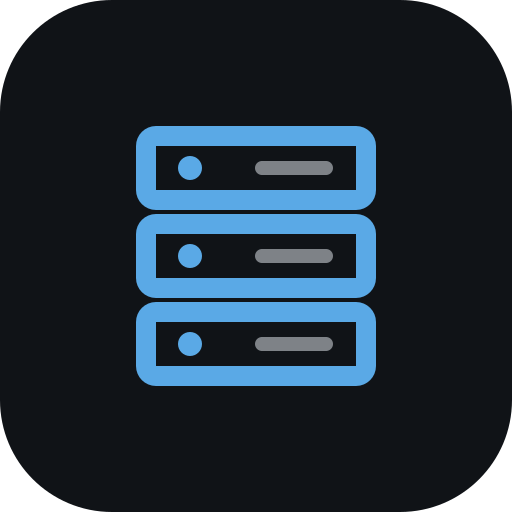
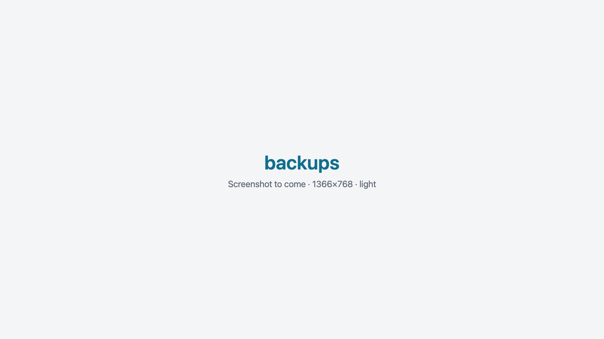

<p align="center">
  
</p>

<h1 align="center">homelab-ngx</h1>

<p align="center">
  An immutable home server OS: Arch, bcachefs, and services you define in Nix.
</p>

<p align="center">
  <a href="https://github.com/homelab-ngx/homelab-ngx/releases/latest"></a>
  <a href="https://github.com/homelab-ngx/homelab-ngx/actions/workflows/image-check.yml"></a>
  <a href="LICENSE"></a>
</p>

<p align="center">
  <a href="https://dl.homelab-ngx.com/installer"><b>Download the installer</b></a>
  &nbsp;|&nbsp;
  <a href="https://github.com/homelab-ngx/homelab-ngx/releases">Release notes</a>
  &nbsp;|&nbsp;
  <a href="#install">Install</a>
</p>

<p align="center">
  <picture>
    <source media="(prefers-color-scheme: dark)" srcset="docs/images/overview-dark.png">
    
  </picture>
</p>

> Version 0.x. Expect breaking changes between releases.

## Features

- The host is a read-only Arch Linux image with two root slots and dm-verity.
  An update is written to the other slot. If it fails to boot three times,
  the host starts the slot before.
- Every service runs in a stack: its own NixOS system in a systemd-nspawn
  container, with its own user namespace, private network, update and
  rollback. A stack update cannot rebuild or restart the host.
- The daemon, the dashboard, the `homelab` CLI and Caddy ship as one system
  extension. It updates without a reboot and leaves stacks running.
- A stack is a git repo with a `flake.nix` and a manifest. You install it by
  URL or write it in the dashboard's editor. Your own app becomes a stack the
  same way.
- A stack can run container images with Podman when upstream ships nothing
  else.
- The manifest lists what the stack needs from the host: hostnames, storage
  paths, the GPU, outbound destinations, forwarded ports, containers, the
  daemon's API. Each is a grant, and the stack gets it when you approve it.
- Variables and secrets are set on the host and encrypted with age. A stack
  repo holds no secret, path or address, so anyone can install it.
- Storage is bcachefs: one pool across drives of different sizes, with
  checksums and replicas. The dashboard mounts a pool, creates subvolumes,
  shows usage and SMART health, and browses files. You create the pool on the
  host with `bcachefs format`.
- Builds are reproducible. A release is built from a tag with pinned inputs
  (a dated Arch snapshot and a `flake.lock`), and the same tag gives the same
  image, bit for bit.
- Releases are signed. A host verifies the signature before it stages an
  update.
- Remote access is set up in the dashboard: a domain with a wildcard
  certificate (DNS-01), a WireGuard VPN, a Cloudflare tunnel, Tailscale.
- Backups go to S3, rclone or restic destinations, and the dashboard lists
  the folders no backup covers. Problems reach you through ntfy or a webhook.
- The host is headless. You install it from a USB stick and do the rest from
  a browser on another device.
- The image is 41 packages and what they depend on, 264 in all. The
  installer is 1.3 GB.

## Why

On most home servers the OS and the services are one system: one NixOS
configuration, one Docker host, one set of packages. A service update can
then rebuild, restart or break the machine everything else runs on, remote
access included.

homelab-ngx keeps the two apart. The host follows SteamOS: a read-only Arch
image in two slots, replaced whole, with the version before kept to fall back
on. It changes rarely and knows nothing about the services it runs.

It does the job you would give Unraid or TrueNAS SCALE: one machine for
storage and services, run from a browser. Both are ahead in storage
management, file sharing and apps. They build and repair arrays in the web
UI, share folders over SMB and NFS, and have large app catalogues.
homelab-ngx has none of the three yet (see [Roadmap](#roadmap)).

What it has is services as code. Nix builds a stack from a commit you chose,
so you can read what runs, pin it, roll it back and build it again next year.
You pull an image someone else assembled only when you ask for one.

We chose bcachefs because one pool takes drives of different sizes, and it
checksums and replicates what it stores. It is maintained outside the mainline
kernel, so the image builds its module from `bcachefs-dkms`.

## Showcase

Stacks, and one stack's page:


Storage and backups:




The installer, opened from another device:


## Requirements

- x86_64 with UEFI, and Secure Boot turned off in the firmware: the kernel
  is not signed.
- A disk of 64 GB or more, either blank or with that much free space next to
  another OS. The system disk can be NVMe, SATA, a USB disk, eMMC, or sit
  behind a RAID or SAS controller (LSI/Broadcom, HPE Smart Array, Adaptec,
  Areca, 3ware); in a VM, a virtio, VMware, Hyper-V or Xen disk.
- 6 GB of RAM or more if the host builds its own updates; less is enough when
  it installs published releases.
- A wired network with DHCP, at least for the install: the installer has no
  Wi-Fi and no setup at the console.

Graphics firmware is in for Intel and AMD, network firmware for Intel,
Realtek and Broadcom cards; Mellanox ConnectX and Aquantia cards need none.
Not in: Wi-Fi, Nvidia, and Fibre Channel cards.

What is tested is what `image/check.sh` boots in a VM: virtio, USB (plain
and UAS), VMware's paravirtual SCSI and a MegaRAID controller. The other
drivers are in the image and have not been run by this project.

## Install

1. Download the installer. https://dl.homelab-ngx.com/installer is the
   newest release's `homelab-ngx_VERSION.img`; each
   [release](https://github.com/homelab-ngx/homelab-ngx/releases) links its
   own.
2. Write the file to a USB stick of 8 GB or more and boot from it.
3. Open the address the console prints, from another device on the same
   network. Pick a blank disk or a free region, set the host name, time zone,
   SSH keys and network, and install.
   With a screen and keyboard on the host, or its first serial port, the
   stick also gives you a root shell there, without a password, to look
   around before installing. The installed host asks for a login.
4. Restart from the page; the stick can stay in until the host is up. Or
   turn the host off there, remove the stick and start it. The host answers
   at `<hostname>.local`.
5. Open the dashboard. The first visit sets its password, so make it soon
   after the install. Then set up the domain, a storage pool, notifications,
   remote access and stacks. A forgotten password is removed on the host
   with `homelab auth reset`.

## Verification

Each release's files are listed in `SHA256SUMS`, which is signed with the
release key. The public key is in this repo, at
[`apps/core/internal/sysupdates/release-signing.asc`](apps/core/internal/sysupdates/release-signing.asc);
its fingerprint is `74BE38EB9E1F070C2AF87E4481D74B7E90B6ADB0`.

```bash
v=0.2.5
curl -fLO https://dl.homelab-ngx.com/$v/homelab-ngx_$v.img
curl -fLO https://dl.homelab-ngx.com/$v/SHA256SUMS -O https://dl.homelab-ngx.com/$v/SHA256SUMS.gpg
curl -fL https://raw.githubusercontent.com/homelab-ngx/homelab-ngx/v$v/apps/core/internal/sysupdates/release-signing.asc | gpg --import
gpg --verify SHA256SUMS.gpg SHA256SUMS
sha256sum -c --ignore-missing SHA256SUMS
```

## Roadmap

None of this is built yet:

- A stack catalogue the dashboard installs from. Today you paste a repo's
  URL.
- Secure Boot, with a signed kernel image.
- A documentation site.
- Creating a pool, and adding or removing its drives, in the dashboard.
- Snapshots.
- Network shares over SMB and NFS.
- ZFS as a second filesystem for pools.
- A CI job that builds each release twice and compares the two.

## Build your own

Builds need Linux, Nix with flakes, and sudo for the image build root.

```bash
make verify        # code generation drift, Go and dashboard tests, nix checks
make image         # the image and the core extension into image/out
make image-check   # boot the built image in a VM: a pool, a stack, an install
```

`make` lists every target. Each target enters the Nix dev shell by itself.

## Documentation

- [CONTRIBUTING.md](CONTRIBUTING.md): how to build, test, change and release
  it.
- [STRATEGY.md](STRATEGY.md): what the project is for and what it will not
  do.
- [CONTEXT.md](CONTEXT.md): the glossary.
- [docs/solutions](docs/solutions): why things are shaped the way they are.
  The [stack contract](docs/solutions/architecture-patterns/stack-contract.md)
  is the place to start when writing a stack.

## License

MIT, see [LICENSE](LICENSE).
