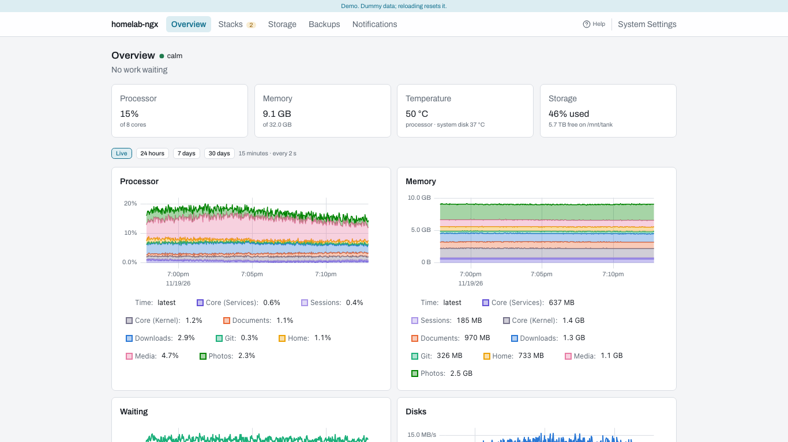
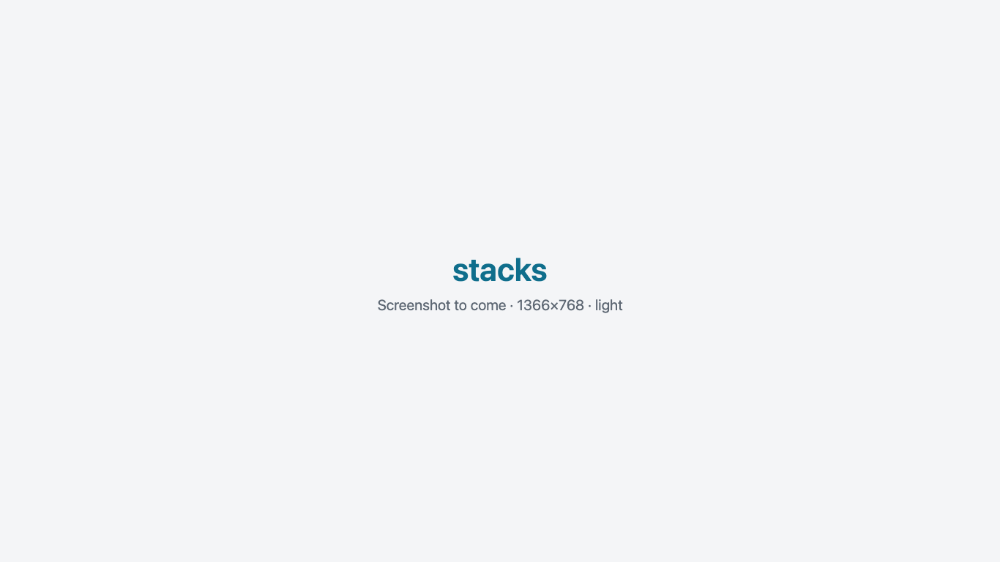
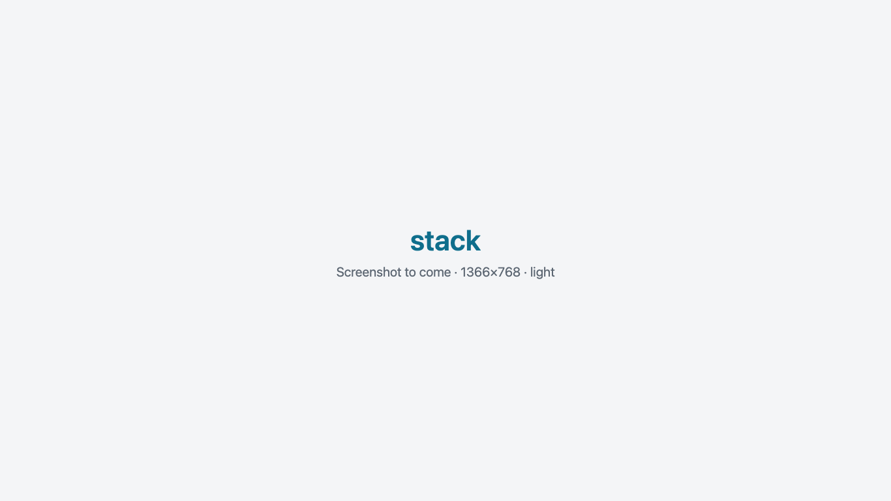
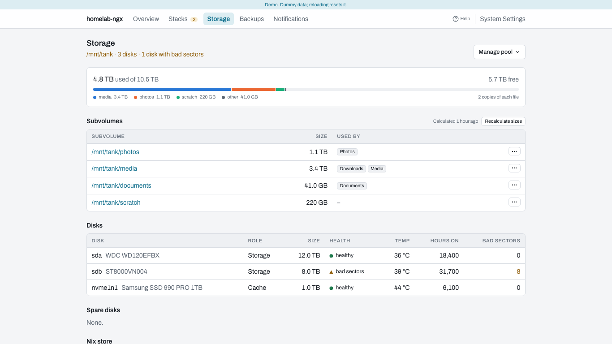
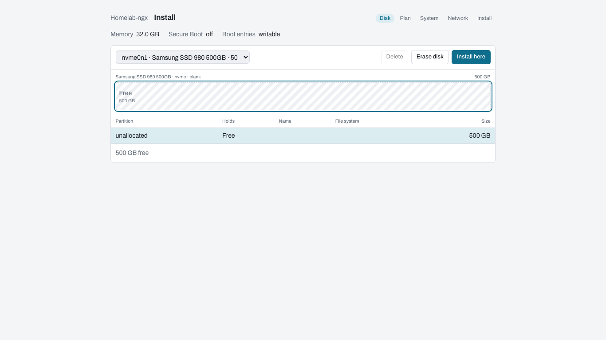

<p align="center">
  
</p>

<h1 align="center">homelab-ngx</h1>

<p align="center">
  An immutable home server OS: Arch, bcachefs, and services you define in Nix.
</p>

<p align="center">
  <a href="https://github.com/homelab-ngx/homelab-ngx/releases/latest"></a>
  <a href="https://github.com/homelab-ngx/homelab-ngx/actions/workflows/image-check.yml"></a>
  <a href="LICENSE"></a>
</p>

<p align="center">
  <a href="https://dl.homelab-ngx.com/installer"><b>Download the installer</b></a>
  &nbsp;|&nbsp;
  <a href="https://demo.homelab-ngx.com">Try the demo</a>
  &nbsp;|&nbsp;
  <a href="https://github.com/homelab-ngx/homelab-ngx/releases">Release notes</a>
  &nbsp;|&nbsp;
  <a href="#install">Install</a>
</p>

<p align="center">
  <picture>
    <source media="(prefers-color-scheme: dark)" srcset="docs/images/overview-dark.png">
    
  </picture>
</p>

> Version 0.x. Expect breaking changes between releases.

## Features

- A read-only Arch image in two slots. An update that fails to boot three
  times falls back.
- Every service you add is a stack: its own NixOS system in a container,
  updated and rolled back alone.
- The daemon, dashboard, CLI and Caddy update together, without a reboot or
  a stack restart.
- A stack is a git repo with a `flake.nix` and a manifest. Install it by
  URL.
- Container images run inside a stack, with Podman.
- A stack gets a hostname, a path, the GPU or a port only when you approve
  it.
- Secrets are set on the host and encrypted with age, never kept in a
  stack's repo.
- bcachefs pools made in the dashboard from one to three copies, with SSDs as
  cache for HDDs. A disk is added or removed while the pool is mounted.
- Reproducible builds: the same tag gives the same image, bit for bit.
- Signed releases, verified by the host before it stages an update.
- Remote access from the dashboard: wildcard certificate, WireGuard,
  Cloudflare tunnel, Tailscale.
- Backups to S3, rclone or restic. Alerts through ntfy or a webhook.
- No screen or keyboard: install from a USB stick, run it from a browser.
- 264 packages. A 1.3 GB installer.

## Why

When the OS and the services are one system, a service update rebuilds the
machine that also carries remote access. A bad one can leave it unreachable.

homelab-ngx keeps the two apart. The host is built the way SteamOS is: a
read-only Arch image in two slots. A stack is code that Nix builds from a
commit you chose, so you can read what runs, pin it and roll it back.

It is for the job you would give Unraid or TrueNAS SCALE. Both manage
arrays in the web UI, share folders over SMB and NFS, and have an app
catalogue. homelab-ngx manages its pools in the dashboard and does not do
the other two yet (see [Roadmap](#roadmap)).

## Screenshots

<picture>
  <source media="(prefers-color-scheme: dark)" srcset="docs/images/stacks-dark.png">
  
</picture>

<picture>
  <source media="(prefers-color-scheme: dark)" srcset="docs/images/stack-dark.png">
  
</picture>

<picture>
  <source media="(prefers-color-scheme: dark)" srcset="docs/images/storage-dark.png">
  
</picture>

<picture>
  <source media="(prefers-color-scheme: dark)" srcset="docs/images/backups-dark.png">
  
</picture>

<picture>
  <source media="(prefers-color-scheme: dark)" srcset="docs/images/installer-dark.png">
  
</picture>

## Requirements

- x86_64 with UEFI. Secure Boot off: the kernel is not signed.
- A 64 GB disk or larger, blank or with that much free space.
- 4 GB of RAM; 6 GB if the host builds its own updates.
- A wired network with DHCP for the install. No Wi-Fi.
- Intel or AMD graphics. No Nvidia.

The image has drivers for NVMe, SATA, USB and eMMC disks and for common RAID
and SAS controllers. The image check boots virtio, USB, VMware SCSI and
MegaRAID disks in a VM; the rest are untested.

## Install

1. Download the [installer](https://dl.homelab-ngx.com/installer).
2. Write it to a USB stick of 8 GB or more. This erases the stick.
3. Boot the host from the stick. Open the address its console prints, from
   another device.
4. Pick a disk, set the host name, time zone, SSH keys and network, then
   install.
5. Restart. Open `<hostname>.local` and set the dashboard's password.

On Linux, step 2 with the stick at `/dev/sdX`:

```bash
sudo dd if=homelab-ngx_VERSION.img of=/dev/sdX bs=4M conv=fsync status=progress
```

The host's own screen and keyboard give a root shell without a login. Root
has no password, and SSH takes keys only: without a key there is no remote
shell. `homelab auth reset` on the host removes a forgotten dashboard
password.

## Coding agents on the host

Claude Code, Codex and opencode can run on the host, as root over SSH.
Install one with Nix; the image has no other package manager:

```bash
nix profile install nixpkgs#opencode      # or nixpkgs#codex
NIXPKGS_ALLOW_UNFREE=1 nix profile install --impure nixpkgs#claude-code
```

The core ships them a guide to the host, its stacks and their logs, in
`/usr/share/homelab/agent`. The daemon links it into each agent's system
config under `/etc`, so an agent reads it with no setup, and it changes with
each core update. It covers running stacks, reading their logs, and adding
a service from a public stack or from a new one written in a local git
repo. It does not cover changing the image.

## Verification

`SHA256SUMS` lists each release's files and is signed with the release key,
`74BE38EB9E1F070C2AF87E4481D74B7E90B6ADB0`. The key is in this repo, at
[`apps/core/internal/sysupdates/release-signing.asc`](apps/core/internal/sysupdates/release-signing.asc).

```bash
v=0.2.5
curl -fLO https://dl.homelab-ngx.com/$v/homelab-ngx_$v.img
curl -fLO https://dl.homelab-ngx.com/$v/SHA256SUMS -O https://dl.homelab-ngx.com/$v/SHA256SUMS.gpg
curl -fL https://raw.githubusercontent.com/homelab-ngx/homelab-ngx/v$v/apps/core/internal/sysupdates/release-signing.asc | gpg --import
gpg --verify SHA256SUMS.gpg SHA256SUMS   # compare the fingerprint it prints
sha256sum -c --ignore-missing SHA256SUMS
```

## Roadmap

Not built yet:

- A stack catalogue in the dashboard.
- Secure Boot.
- A documentation site.
- Replacing a failed disk, changing a pool's copies, and encrypted pools in
  the dashboard. Today these are done with `bcachefs` in a shell.
- bcachefs snapshots.
- Network shares over SMB and NFS.
- ZFS pools.
- A CI job that builds each release twice and compares the two.

## Build your own

Needs Linux, Nix with flakes, and sudo. `make` lists every target.

```bash
make verify        # tests and checks
make image         # the image and the core extension, into image/out
make image-check   # boot the built image in a VM
```

## Documentation

- [CONTRIBUTING.md](CONTRIBUTING.md): build, test, change and release it.
- [Issues](https://github.com/homelab-ngx/homelab-ngx/issues): report a
  problem or ask a question.

## License

MIT, see [LICENSE](LICENSE).
